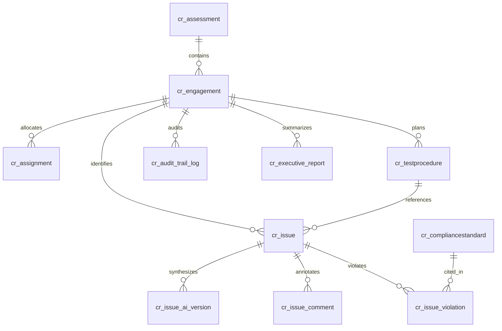

# Dataverse Schema & Data Model Specification (Foundational)
## Entity Definitions, Relational Architecture & OptionSets

---

## 1. Executive Purpose & Scope

This document provides the foundational Dataverse schema definition for the **IAR (Intelligent Audit Reporting)** platform, translating the 18 mock JSON datasets from `Backup_JNJ_IAR/src/data/` into normalized Microsoft Dataverse tables.

*(Note: Detailed entity column attributes, calculated rollups, and security roles will be expanded in a subsequent phase).*

---

## 2. Core Entity Relational Diagram (ERD)

---

## 3. Entity Catalog & Primary Keys

| Target Dataverse Entity | Display Name | Replaces Mock Source | Primary Key Column | Key Description |
| :--- | :--- | :--- | :--- | :--- |
| **`cr_assessment`** | Annual Assessment Portfolio | `assessments.json` | `cr_assessmentid` (GUID) | Annual audit plans (e.g. `ASM-2026`). |
| **`cr_engagement`** | Audit Engagement Project | `engagements.json` | `cr_engagementid` (GUID) | Specific audit jobs (e.g. `REP-2026-001`). |
| **`cr_assignment`** | Role Assignment | `assignments.json` | `cr_assignmentid` (GUID) | Maps users and roles to specific engagements. |
| **`cr_testprocedure`** | Test Procedure Workprogram | `testProcedures.json` | `cr_testprocedureid` (GUID) | Standard test steps (e.g. `TP-101`). |
| **`cr_issue`** | Audit Finding / Issue | `issues.json` | `cr_issueid` (GUID) | Core findings, root causes, and recommendations. |
| **`cr_issue_ai_version`**| AI Synthesis Version | `issueAiVersions.json` | `cr_versionid` (GUID) | Immutable ledger of AI generated drafts. |
| **`cr_issue_comment`** | Field Comment | `comments.json` | `cr_commentid` (GUID) | Field-level discussion threads and resolutions. |
| **`cr_compliancestandard`**| Compliance Standard | `complianceStandards.json` | `cr_standardid` (GUID) | Master catalog of SOX, GxP, ISO, and IAPP rules. |
| **`cr_issue_violation`** | Finding Violation | `issueViolations.json` | `cr_violationid` (GUID) | Junction table between issues and standards. |
| **`cr_audit_trail_log`** | Audit Trail Log | `auditReportLogs.json` | `cr_logid` (GUID) | Immutable GxP / SOX transition logs. |
| **`cr_executive_report`**| Executive Summary Report | `execReportData.js` | `cr_execreportid` (GUID) | High-level executive narrative and scope matrix. |

---

## 4. Key Global Choice / OptionSets

### 4.1 Engagement Status (`cr_engagement_status`)
- `100000000`: Not Started
- `100000001`: Audit Report In Progress
- `100000002`: Executive Report In Progress
- `100000003`: Completed

### 4.2 Issue Status (`cr_issue_status`)
- `200000000`: Pending Staff
- `200000001`: Pending TC
- `200000002`: Pending Manager
- `200000003`: Pending with Business
- `200000004`: Manager Completed (Waiting on Others)
- `200000005`: Ready for Director Submission
- `200000006`: Pending Director
- `200000007`: Pending VP
- `200000008`: Completed / Signed Off

### 4.3 Issue Criticality (`cr_issue_criticality`)
- `300000000`: Critical
- `300000001`: Major
- `300000002`: Moderate
- `300000003`: Minor
- `300000004`: Informational
