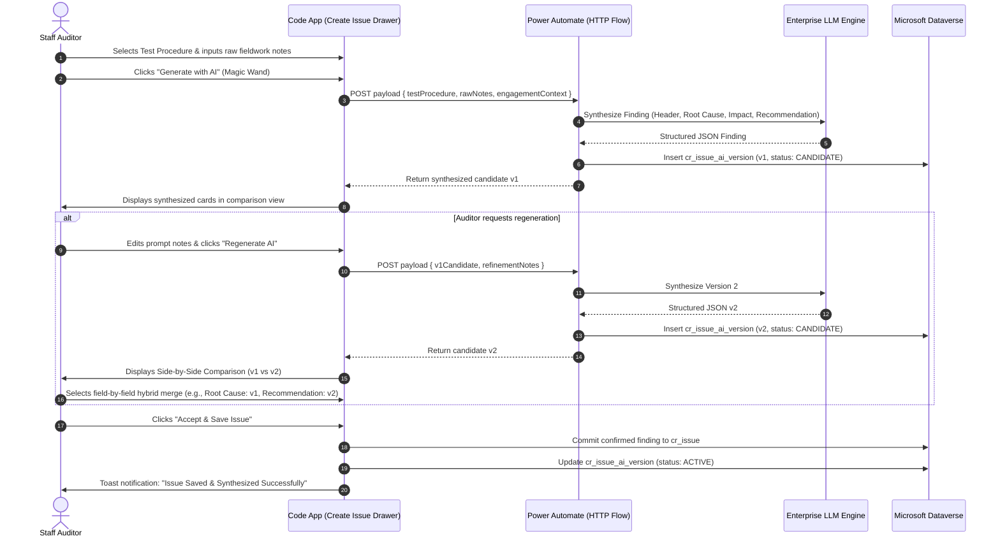
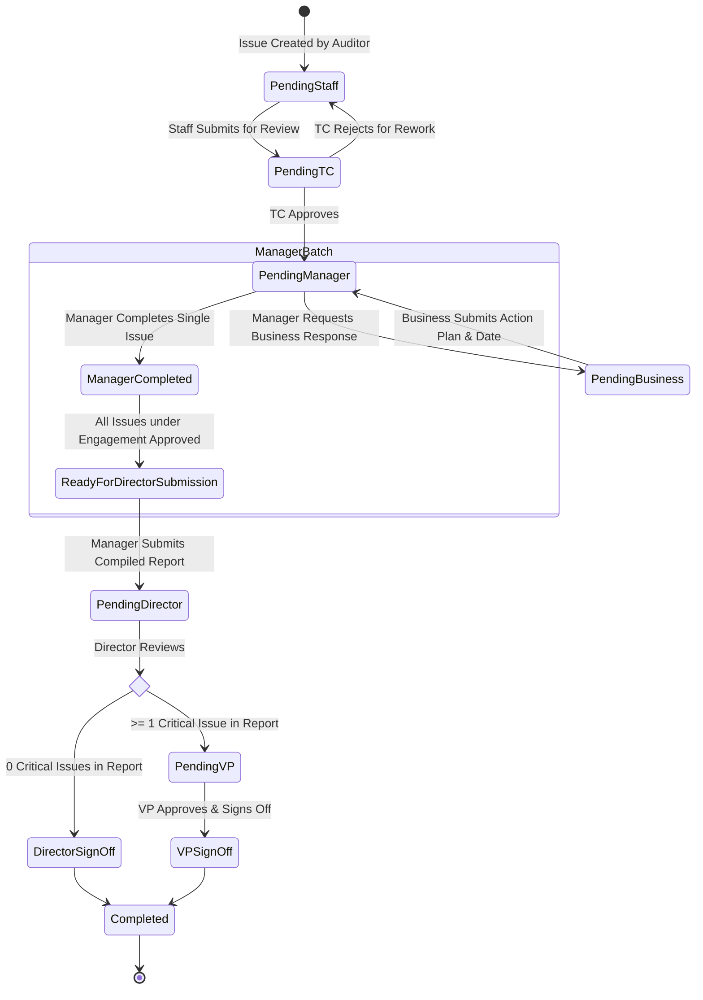

# Functional Requirements Document (FRD)
## IAR Module: Reporting & Finding Governance

---

## 1. Document Control & Objective

| Property | Value |
| :--- | :--- |
| **Document Title** | Functional Requirements Document — Reporting Module |
| **System Name** | Intelligent Audit Reporting (IAR) Platform |
| **Target Architecture** | Power Apps Code App (React/TS), Dataverse, Power Automate, SharePoint, ADLS |
| **Module Scope** | **Reporting Module** (Full End-to-End Implementation) |
| **Reference Sources** | [Backup_JNJ_IAR](file:///d:/IAR/Backup_JNJ_IAR/) (Business Logic), [Backup_IAR-components](file:///d:/IAR/Backup_IAR-components/) (UI System) |

### 1.1 Business Purpose
The **Reporting Module** is the core operational studio of the IAR platform. It facilitates:
1. Aggregating fieldwork observations into formally documented, compliant audit findings.
2. Synthesizing complex findings and recommendations using enterprise AI.
3. Conducting structured multi-tier supervisory reviews across IT and FinOps governance lines.
4. Orchestrating auditee business responses and remediation date commitments.
5. Providing concurrent drafting and executive sign-off for Executive Summary reports.
6. Enforcing strict regulatory compliance (GxP, SOX, ISO, IAPP) with immutable audit logging.

---

## 2. Multi-Role Governance & Permission Matrix

The Reporting Module enforces strict role-based access control (RBAC) across two primary audit domains (**IT** and **FinOps**) plus case-based **Business Contacts**:

```mermaid
graph TD
    classDef staff fill:#f1f5f9,stroke:#64748b,stroke-width:2px,color:#0f172a;
    classDef tc fill:#eff6ff,stroke:#3b82f6,stroke-width:2px,color:#1e3a8a;
    classDef mgr fill:#fef3c7,stroke:#f59e0b,stroke-width:2px,color:#78350f;
    classDef dir fill:#f3e8ff,stroke:#a855f7,stroke-width:2px,color:#581c87;
    classDef vp fill:#ffe4e6,stroke:#f43f5e,stroke-width:2px,color:#881337;
    classDef biz fill:#e0f2fe,stroke:#0284c7,stroke-width:2px,color:#0369a1;

    STAFF["1. Staff Auditor<br/>(Draft Findings & AI Synthesis)"]:::staff
    TC["2. Team Coordinator (TC)<br/>(Technical & Evidence Review)"]:::tc
    MGR["3. Audit Manager<br/>(Supervisory Review & Business Routing)"]:::mgr
    BIZ["Business Contact<br/>(Action Plan & Target Date)"]:::biz
    DIR["4. Audit Director<br/>(Executive Quality Review & Sign-Off)"]:::dir
    VP["5. Vice President (VP)<br/>(Mandatory Gate for Critical Issues)"]:::vp

    STAFF -->|Submit Finding| TC
    TC -->|Approve & Advance| MGR
    MGR <-->|Send for Response| BIZ
    MGR -->|Batch Submit All Issues| DIR
    DIR -->|Standard Sign-Off (0 Critical)| Done["Engagement Completed"]
    DIR -->|Escalate (>= 1 Critical)| VP
    VP -->|Executive Sign-Off| Done
```

### 2.1 Role Permissions Matrix

| Operational Capability | Staff Auditor | Team Coordinator (TC) | Audit Manager | Audit Director | Vice President (VP) | Business Contact |
| :--- | :---: | :---: | :---: | :---: | :---: | :---: |
| **Create New Finding / Issue** | ✅ Yes | ✅ Yes | ✅ Yes | ❌ Read Only | ❌ Read Only | ❌ No |
| **Trigger Initial AI Synthesis** | ✅ Yes | ✅ Yes | ✅ Yes | ❌ No | ❌ No | ❌ No |
| **Regenerate & Compare AI Versions** | ✅ Yes | ✅ Yes | ✅ Yes | ❌ No | ❌ No | ❌ No |
| **Edit Workpaper Finding Content** | When `Pending Staff` | When `Pending TC` | When `Pending Manager` | When `Pending Director` | When `Pending VP` | ❌ No |
| **Submit to Team Coordinator** | ✅ Yes | ❌ N/A | ❌ N/A | ❌ N/A | ❌ N/A | ❌ No |
| **Submit to Audit Manager** | ❌ No | ✅ Yes | ❌ N/A | ❌ N/A | ❌ N/A | ❌ No |
| **Route to Business for Response** | ❌ No | ❌ No | ✅ Yes | ✅ Yes | ❌ No | ❌ N/A |
| **Submit Action Plan & Date** | ❌ No | ❌ No | ❌ No | ❌ No | ❌ No | ✅ Yes |
| **Submit Batch to Director** | ❌ No | ❌ No | ✅ Yes (All issues ready) | ❌ N/A | ❌ N/A | ❌ No |
| **Final Sign-Off (No Critical Issues)**| ❌ No | ❌ No | ❌ No | ✅ Yes | ✅ Yes | ❌ No |
| **Final Sign-Off ($\ge 1$ Critical Issue)**| ❌ No | ❌ No | ❌ No | ❌ Blocked | ✅ Mandatory | ❌ No |
| **Add Field-Level Comments** | ✅ Yes | ✅ Yes | ✅ Yes | ✅ Yes | ✅ Yes | ✅ Yes |
| **Resolve Tagged `@mention` Comment**| Only if tagged | Only if tagged | Only if tagged | Only if tagged / Lead | Only if tagged / Admin | Only if tagged |

---

## 3. UI Views & Screen Specifications

The Reporting Module consists of four primary integrated views:

### 3.1 View 1: My Audits (Audit Queue Landing Page)
- **Purpose**: Personalized dashboard and engagement queue where auditors and supervisors access their assigned audits.
- **Header KPI Summary Bar**:
  - Total Engagements Assigned.
  - In Progress Reports count.
  - Completed Reports count.
  - Critical Findings count across active portfolio.
- **Engagement Portfolio Tabs**:
  - `All Audits`
  - `My Active Queue`
  - `Pending My Review` (filtered by active user role)
  - `Completed Audits`
- **Filter & Search Toolbar**:
  - Search by Engagement Name, Report ID (`REP-2026-xxx`), Lead Auditor, or Business Unit.
  - Filter by Assessment Year (`2025`, `2026`, `2027`).
  - Filter by Domain (`IT`, `FinOps`).
  - Filter by Criticality (`Critical`, `Major`, `Moderate`, `Minor`).
- **Engagement Card / Table Structure**:
  - Implemented using the standardized [`SharedTable`](file:///d:/IAR/Backup_IAR-components/src/components/shared/SharedTable.tsx).
  - Columns: Engagement ID, Audit Title, Domain, Lead Auditor, Overall Status (`Not Started`, `Audit Report Inprogress`, `Executive Report Inprogress`, `Completed`), Discussion Points / Issue Count, Criticality Badge, Actions.
  - **Row Action Buttons**:
    - `Work on Audit Report` $\rightarrow$ Navigates to View 2.
    - `Work on Executive Summary` $\rightarrow$ Navigates to View 3.
    - `+ Create Issue` (Available for Auditors when engagement is `Not Started` or active).

---

### 3.2 View 2: Audit Report Studio (Workpaper Editor)
- **Purpose**: Primary workspace for drafting, refining, reviewing, and approving detailed audit findings.
- **Split Screen / Master-Detail Layout**:
  - **Left Sidebar — Finding Navigator**:
    - List of all issues under the selected engagement.
    - Displays Issue Code (`ISSUE-001`), Test Procedure Badge (`TP-101`), Criticality Chip (`Critical`, `Major`, etc.), and Review Status (`Pending TC`, `Pending Manager`, etc.).
    - Filter navigator by status and criticality.
    - "+ Add Issue" action button at top of navigator.
  - **Right Panel — Finding Workpaper Editor**:
    - **Header Block**: Issue Title, Test Procedure Reference, Criticality selector, Accountable Process Area, Accountable Function.
    - **Workpaper Body Sections** (Collapsible via [`SharedAccordion`](file:///d:/IAR/Backup_IAR-components/src/components/shared/SharedAccordion.tsx)):
      1. *Executive Summary of Finding & Detailed Observation*.
      2. *Root Cause Analysis*.
      3. *Business, Financial & Compliance Impact*.
      4. *Audit Recommendations*.
      5. *Mitigating Controls & Interim Safeguards*.
      6. *Applicable Compliance Standards & Policy Citations*.
      7. *Agreed Management Response & Target Remediation Date* (Editable when in `Pending with Business`).
    - **In-Situ Collaboration Trigger**: Every field includes a comment bubble showing unresolved comment counts.
    - **AI Assistance Bar**: Quick action button: `"AI Refine / Regenerate Finding"` to trigger LLM synthesis.
    - **Bottom Sticky Action Footer**:
      - Status pill showing current queue and reviewer.
      - Dynamic transition buttons based on current state (e.g., `Save Draft`, `Submit to TC`, `Approve & Route to Manager`, `Send for Business Response`, `Submit to Director`, `Execute Final Sign-Off`).

---

### 3.3 View 3: Executive Summary Report Studio
- **Purpose**: High-level synthesis report delivered to Audit Committee, VP, and Board.
- **Concurrency Principle**: Can be drafted and reviewed **in parallel** with the detailed Audit Report.
- **Core Sections**:
  1. **Assessment Objective & Scope**: High-level audit boundaries, facilities covered, systems audited.
  2. **Operational Process Scope Matrix**: Multi-column matrix listing Process Areas, Control Adequacy, and Severity Counts (Critical, Major, Moderate, Minor).
  3. **Key Audit Insights & Executive Narrative**: AI-consolidated executive summary highlighting systemic risks.
  4. **Critical Finding Highlights**: Direct summary cards of any Critical or Major findings elevated from the Audit Report.
  5. **Review & Sign-Off Block**: Two-tier sign-off mechanism (Director signature, plus VP signature if Critical issues exist).

---

### 3.4 View 4: Cross-Engagement Audit Issues View
- **Purpose**: Comprehensive data grid of all individual findings across all annual engagements.
- **Features**:
  - Multi-column sortable grid via [`SharedTable`](file:///d:/IAR/Backup_IAR-components/src/components/shared/SharedTable.tsx).
  - Bulk filter by Test Procedure, Lead Auditor, Remediation Date, and Status.
  - Quick Drawer preview of any finding upon row selection.

---

## 4. Detailed Functional Workflows

### 4.1 Finding Creation & AI Synthesis Lifecycle



#### Lifecycle Rules:
1. **Immutable AI Ledger**: Every generation and regeneration creates an immutable record in `cr_issue_ai_version`.
2. **Active State Isolation**: Downstream reviews only see the active confirmed record in `cr_issue`.
3. **Hybrid Field Merging**: Reviewers are never forced into an "all-or-nothing" choice between versions; they can pick individual fields from different versions.

---

### 4.2 Issue Review State Machine & Criticality Escalation



#### State Transition Rules:
1. **`Pending Staff`**: Initial drafting stage. Only the assigned Auditor can edit.
2. **`Pending TC`**: Team Coordinator review. Validates workprogram alignment and evidence sufficiency.
3. **`Pending Manager`**: Supervisory review by Audit Manager.
4. **`Pending with Business`**: Business Contact enters management response, corrective action plan, and remediation target date. Form is locked from internal audit edits while with business.
5. **Manager Batch Logic (`Manager Completed` vs `Ready for Director Submission`)**:
   - When a manager approves an issue, if other issues in the same engagement are still pending, the issue enters `Manager Completed (Waiting on Other Issues)`.
   - As soon as the **last remaining issue** in the engagement is completed by the Manager, **all issues automatically transition to `Ready for Director Submission`**.
6. **Criticality Gate**:
   - If **all issues** are `Major`, `Moderate`, or `Minor`, the **Audit Director** performs the final sign-off.
   - If **at least one issue** is `Critical`, the system automatically locks Director sign-off and routes the entire engagement to the **Vice President (VP)** for executive sign-off.

---

### 4.3 Field-Level Collaboration & Strict Resolution Governance

#### Collaboration Types:
1. **Generic Collaboration Comments**:
   - For open questions, general policy inquiries, or draft suggestions.
   - **Resolution Rule**: Any active review participant (Auditor, TC, Manager, Director, VP) can mark as resolved.
2. **Tagged Person Comments (`@mention`)**:
   - Created when tagging a specific team member (e.g. `@Amanda Palmer`).
   - **Strict Resolution Lock Rule**: **ONLY the tagged individual** is permitted to click "Mark as Done". For all other users, the button is disabled with a lock tooltip:
     > *"Assigned to [Tagged User] — only the tagged recipient can resolve this comment."*
   - **Administrative Override**: Lead Auditor or Director can override with mandatory logged justification.

---

## 5. Non-Functional & Compliance Requirements

1. **GxP / SOX Compliance Audit Logging**:
   - Every status transition, AI adoption, field modification, and sign-off must generate an immutable entry in `cr_audit_trail_log`.
   - Stored attributes: `log_id`, `entity_name`, `record_id`, `action_type`, `previous_state`, `new_state`, `user_id`, `user_role`, `timestamp`, `ip_client`.
2. **Data Concurrency & Record Locking**:
   - When a user opens an issue in edit mode, a soft record lock (`isLocked`, `lockedBy`, `lockedAt`) is placed to prevent concurrent overwrite collisions.
   - Locks automatically release after 15 minutes of inactivity or upon save/exit.
3. **Accessibility & Responsive Standards**:
   - Minimum WCAG 2.1 AA compliance across all Power Apps Code App screens.
   - Seamless scaling across 1080p, 1440p, and laptop resolutions (1366x768 minimum viewport).
