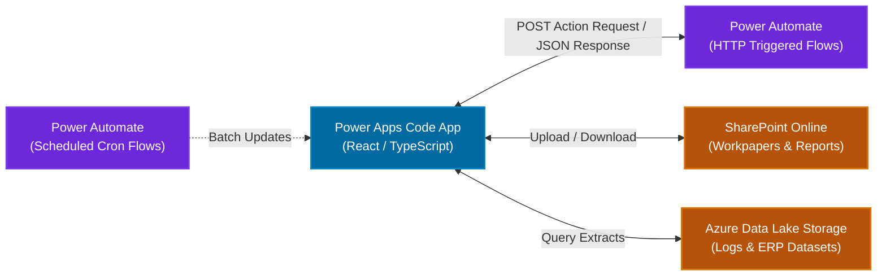

# Integration & Automation Specification (Foundational)
## Power Automate, SharePoint & Azure Data Lake Storage (ADLS)

---

## 1. Executive Purpose & Architecture Overview

This document defines the foundational integration contracts, automation triggers, and storage pathways connecting the **Power Apps Code App** with external Microsoft Power Platform services:



*(Note: Detailed JSON schema contracts, security authentications, and error handling policies will be expanded in a subsequent phase).*

---

## 2. Power Automate: Instant / HTTP Flow Catalog

These flows are invoked directly via HTTP connector requests triggered by user interactions within the Code App:

| Flow Identifier | Triggering Event in UI | Input Payload Summary | Target Output / Action |
| :--- | :--- | :--- | :--- |
| **`FLW-IAR-GenerateAiFinding`** | "Generate with AI" button | `{ testProcedureId, rawNotes, engagementId }` | Synthesizes finding via LLM; stores candidate v1 in Dataverse; returns JSON fields. |
| **`FLW-IAR-RegenerateAiVersion`**| "Regenerate AI" button | `{ versionId, refinementNotes }` | Synthesizes candidate v2; returns candidate for side-by-side comparison. |
| **`FLW-IAR-AdvanceWorkflowStage`**| Submit / Approve buttons | `{ issueId, targetStatus, reviewerRemarks }` | Updates issue status in Dataverse; creates immutable audit log; sends notification. |
| **`FLW-IAR-RouteToBusiness`** | "Send for Business Response" | `{ issueId, businessContactId, notes }` | Updates status to `Pending with Business`; sends email with deep-link to Code App. |
| **`FLW-IAR-CompileAndExportReport`**| "Export Report" button | `{ engagementId, reportType: 'audit' \| 'exec' }`| Compiles data; converts to PDF; uploads to SharePoint; returns download link. |

---

## 3. Power Automate: Scheduled Background Flows

| Flow Identifier | Schedule Frequency | Target Purpose |
| :--- | :--- | :--- |
| **`FLW-IAR-DailyStatusAggregation`** | Nightly at 00:00 UTC | Recalculates engagement overall statuses, critical finding tallies, and KPI metrics. |
| **`FLW-IAR-SlaReviewAlerts`** | Daily at 08:00 AM | Scans active queues (`Pending TC`, `Pending Manager`, `Pending Director`); dispatches SLA reminder emails for items > 5 business days. |
| **`FLW-IAR-RemediationDateTracker`**| Weekly on Mondays | Evaluates agreed business remediation dates; flags overdue action plans to Audit Director. |

---

## 4. File Storage: SharePoint Online Architecture

- **Root Site**: `/sites/JohnsonAndJohnson-IAR`
- **Primary Document Library**: `AuditWorkpapers`
- **Folder Structure**:
  ```
  AuditWorkpapers/
  └── Engagements/
      └── {cr_engagement_id}/
          ├── Evidence/               <-- Auditor evidence uploads, test files, screenshots
          ├── BusinessResponses/      <-- Evidence submitted by auditee business contacts
          └── FinalReports/           <-- Official signed-off Audit & Executive PDF reports
  ```

---

## 5. Big Data & Telemetry Storage: Azure Data Lake Storage (ADLS Gen2)

- **Storage Account**: `stjnjiarprod`
- **Containers**:
  1. `iar-forensic-logs`: High-velocity immutable GxP event logs, detailed field delta diffs, and security audit records streamed from Power Automate.
  2. `iar-enterprise-extracts`: Read-only staging extracts from SAP, TrackWise, and J&J enterprise ERP systems queried by auditors for sample population testing.
