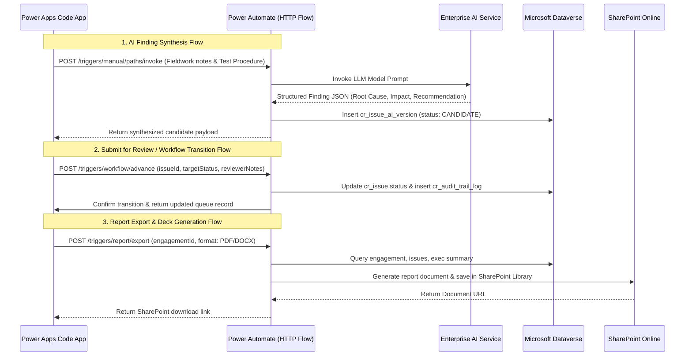

# IAR Reference & Traceability Mapping Guide
## Cross-Reference Matrix for Backup Repositories, Dataverse, Automations & UI System

---

## 1. Executive Purpose & Repository Roles

This document serves as the master architectural directory mapping between the reference backup repositories and the target **Power Apps Code App** production application:

```
┌────────────────────────────────────────────────────────┐
│                      d:/IAR/                           │
├──────────────────────────┬─────────────────────────────┤
│ Backup_JNJ_IAR/          │ Backup_IAR-components/      │
│ [FUNCTIONAL BLUEPRINT]   │ [DESIGN SYSTEM & BRANDING]  │
│ - Audit Business Logic   │ - J&J Brand Colors & Theme  │
│ - Workflow State Machine │ - Shared UI Components      │
│ - Multi-Role Governance  │ - SharedTable & Accordion   │
│ - AI Versioning & Merge  │ - Standardized Form Inputs  │
│ - Mock JSON Data         │ - Consistent Look & Feel    │
└──────────────────────────┴─────────────────────────────┘
                             │
                             ▼
┌────────────────────────────────────────────────────────┐
│               TARGET PRODUCTION BUILD                  │
│  - Power Apps Code App (Frontend React / TypeScript)   │
│  - Microsoft Dataverse (Relational System of Record)   │
│  - Power Automate (HTTP Button Flows & Scheduled Jobs) │
│  - SharePoint (Audit Workpapers & Report Attachments)  │
│  - Azure Data Lake Storage / ADLS (Telemetry & Logs)   │
└────────────────────────────────────────────────────────┘
```

---

## 2. Source Repositories Cross-Reference

### 2.1 `Backup_JNJ_IAR/` (Business Logic & Functional Blueprint)

| Path in `Backup_JNJ_IAR/` | Artifact Type | Purpose & Business Logic Extracted |
| :--- | :--- | :--- |
| [AUDIT_WORKFLOW_AND_DATA_HIERARCHY.md](file:///d:/IAR/Backup_JNJ_IAR/AUDIT_WORKFLOW_AND_DATA_HIERARCHY.md) | Spec | Master data hierarchy (Assessment $\rightarrow$ Engagement $\rightarrow$ Assignment $\rightarrow$ Test Procedure $\rightarrow$ Issue), workflow statuses, and sign-off criteria. |
| [AiVersionManagement.md](file:///d:/IAR/Backup_JNJ_IAR/AiVersionManagement.md) | Spec | 3-phase AI lifecycle: Initial draft synthesis, candidate regeneration, version comparison, and hybrid field-by-field merge. |
| [CommentsManagement.md](file:///d:/IAR/Backup_JNJ_IAR/CommentsManagement.md) | Spec | Field-level comment threads, `@mention` tagging, and strict resolution lock (only tagged user can mark as done). |
| [ComplianceStandardsManagement.md](file:///d:/IAR/Backup_JNJ_IAR/ComplianceStandardsManagement.md) | Spec | Compliance taxonomy mapping (SOX, GxP, ISO, IAPP) and policy violation attribution. |
| [FunctionLogManagement.md](file:///d:/IAR/Backup_JNJ_IAR/FunctionLogManagement.md) | Spec | Audit trail logging, status transition history, and regulatory traceability. |
| [TaxonomyManagement.md](file:///d:/IAR/Backup_JNJ_IAR/TaxonomyManagement.md) | Spec | Audit classification taxonomies (Process areas, Risk categories, Root Cause categories). |
| [src/views/MyAuditsView.jsx](file:///d:/IAR/Backup_JNJ_IAR/src/views/MyAuditsView.jsx) | View | Primary Audit Queue: Portfolio tabs, search/filter, engagement cards, status badges, and action triggers. |
| [src/views/AuditReportView.jsx](file:///d:/IAR/Backup_JNJ_IAR/src/views/AuditReportView.jsx) | View | Detailed Audit Report Studio: Finding workpapers, root cause, impact, recommendations, business responses, and approvals. |
| [src/views/ExecutiveReportView.jsx](file:///d:/IAR/Backup_JNJ_IAR/src/views/ExecutiveReportView.jsx) | View | Executive Summary Report: High-level narrative, process scope matrix, key insights, and VP/Director executive sign-off. |
| [src/views/AuditIssuesView.jsx](file:///d:/IAR/Backup_JNJ_IAR/src/views/AuditIssuesView.jsx) | View | Cross-engagement audit issues ledger with filtering, sorting, and status chips. |
| [src/components/issues/CreateIssueDrawerNew.jsx](file:///d:/IAR/Backup_JNJ_IAR/src/components/issues/CreateIssueDrawerNew.jsx) | Component | Issue creation workflow drawer featuring "Generate with AI" button, prompt synthesis, and in-drawer candidate comparison. |
| [src/components/issues/AiVersionCompareModal.jsx](file:///d:/IAR/Backup_JNJ_IAR/src/components/issues/AiVersionCompareModal.jsx) | Component | Multi-version side-by-side comparison modal with diff highlighting and field selection controls. |
| [src/components/issues/DiscussionModal.jsx](file:///d:/IAR/Backup_JNJ_IAR/src/components/issues/DiscussionModal.jsx) | Component | Field-level discussion thread modal supporting user tagging and resolution status. |
| [src/components/issues/IssueLogsModal.jsx](file:///d:/IAR/Backup_JNJ_IAR/src/components/issues/IssueLogsModal.jsx) | Component | Historical transition log modal showing user attribution, timestamp, and review remarks. |
| [src/components/reporting/WorkflowModal.jsx](file:///d:/IAR/Backup_JNJ_IAR/src/components/reporting/WorkflowModal.jsx) | Component | Engagement-level review progression modal detailing stage transitions and current approver. |

---

### 2.2 `Backup_IAR-components/` (Design System & Standardized UI Components)

| Path in `Backup_IAR-components/` | Component / File | Purpose & UI Consistency Role |
| :--- | :--- | :--- |
| [src/mui.theme.tsx](file:///d:/IAR/Backup_IAR-components/src/mui.theme.tsx) | Theme Definition | Standard J&J corporate brand palette: Red (`#eb1700`), Blue (`#000099`), Black (`#212121`), Grey (`#888b8d`, `#d8d8d8`), typography (`jj-circular`, Arial), component overrides. |
| [src/components/shared/SharedTable.tsx](file:///d:/IAR/Backup_IAR-components/src/components/shared/SharedTable.tsx) | `SharedTable` | Replaces custom/ad-hoc tables in `MyAuditsView` and `AuditIssuesView` with standard pagination, sorting, row selection, and styling. |
| [src/components/shared/SharedAccordion.tsx](file:///d:/IAR/Backup_IAR-components/src/components/shared/SharedAccordion.tsx) | `SharedAccordion` | Replaces custom collapsible sections in `AuditReportView` workpapers and finding groups. |
| [src/components/shared/buttons/SharedButton.tsx](file:///d:/IAR/Backup_IAR-components/src/components/shared/buttons/SharedButton.tsx) | `SharedButton` | Standardized button component (`contained`, `outlined`, `text`) enforcing consistent sizing, colors, and loading states across all drawers and views. |
| [src/components/shared/inputs/SharedTextInput.tsx](file:///d:/IAR/Backup_IAR-components/src/components/shared/inputs/SharedTextInput.tsx) | `SharedTextInput` | Standard text field for issue headers, IDs, and search bars. |
| [src/components/shared/inputs/SharedTextArea.tsx](file:///d:/IAR/Backup_IAR-components/src/components/shared/inputs/SharedTextArea.tsx) | `SharedTextArea` | Standard multi-line text area for Root Cause, Finding Description, Impact, Recommendation, and Management Response. |
| [src/components/shared/inputs/SharedSelect.tsx](file:///d:/IAR/Backup_IAR-components/src/components/shared/inputs/SharedSelect.tsx) | `SharedSelect` | Standard single-select dropdown for Criticality, Status, Process Area, and Risk Category. |
| [src/components/shared/inputs/SharedMultiSelect.tsx](file:///d:/IAR/Backup_IAR-components/src/components/shared/inputs/SharedMultiSelect.tsx) | `SharedMultiSelect` | Multi-select dropdown for Compliance Standards, Assigned Auditors, and Tagged Reviewers. |
| [src/components/shared/inputs/SharedAutocomplete.tsx](file:///d:/IAR/Backup_IAR-components/src/components/shared/inputs/SharedAutocomplete.tsx) | `SharedAutocomplete` | Searchable autocomplete for Test Procedure selection and User directory lookups. |
| [src/components/shared/inputs/SharedRadioGroup.tsx](file:///d:/IAR/Backup_IAR-components/src/components/shared/inputs/SharedRadioGroup.tsx) | `SharedRadioGroup` | Radio group for binary choices (e.g., Repeat Finding Yes/No, Report Type selection). |
| [src/components/shared/common/SharedFieldLabel.tsx](file:///d:/IAR/Backup_IAR-components/src/components/shared/common/SharedFieldLabel.tsx) | `SharedFieldLabel` | Uniform field labels with required indicator styling. |
| [src/components/shared/common/SharedFieldError.tsx](file:///d:/IAR/Backup_IAR-components/src/components/shared/common/SharedFieldError.tsx) | `SharedFieldError` | Standard validation error message rendering. |

---

## 3. Data Transformation Map: Mock JSON to Microsoft Dataverse

| Mock JSON Source in `Backup_JNJ_IAR/src/data/` | Target Microsoft Dataverse Entity | Entity Description & Key Columns |
| :--- | :--- | :--- |
| `assessments.json` | `cr_assessment` | Annual audit portfolios (`cr_assessmentid`, `cr_name`, `cr_year`, `cr_status`). |
| `engagements.json` | `cr_engagement` | Audit projects (`cr_engagementid`, `cr_assessmentid_lookup`, `cr_title`, `cr_status`, `cr_substatus`, `cr_lead_auditor`, `cr_criticality`). |
| `assignments.json`, `assignmentsData.js` | `cr_assignment` | Role-to-engagement mapping (`cr_assignmentid`, `cr_engagementid_lookup`, `cr_role`, `cr_user_lookup`). |
| `roles.json` | Global OptionSet / `cr_role` | Predefined audit roles (`it-auditor`, `it-manager`, `it-director`, `it-vp`, `finops-auditor`, `business-contact`). |
| `users.json` | `systemuser` / Entra ID | Enterprise users with AD profile, email, department, avatar, and persona mapping. |
| `testProcedures.json` | `cr_testprocedure` | Approved workprograms (`cr_testprocedureid`, `cr_code`, `cr_title`, `cr_domain`, `cr_engagementid_lookup`). |
| `issues.json` | `cr_issue` | Audit findings (`cr_issueid`, `cr_engagementid_lookup`, `cr_testprocedureid_lookup`, `cr_title`, `cr_criticality`, `cr_status`, `cr_rootcause`, `cr_impact`, `cr_recommendation`, `cr_managementresponse`, `cr_remediationdate`). |
| `issueAiVersions.json` | `cr_issue_ai_version` | Immutable ledger of AI generations (`cr_versionid`, `cr_issueid_lookup`, `cr_versionnumber`, `cr_promptcontext`, `cr_synthesizedpayload`, `cr_adoptedfields`, `cr_status`). |
| `comments.json` | `cr_issue_comment` | Field-level collaboration threads (`cr_commentid`, `cr_issueid_lookup`, `cr_fieldkey`, `cr_taggeduserid_lookup`, `cr_status`, `cr_content`, `cr_resolvedby_lookup`). |
| `complianceStandards.json` | `cr_compliancestandard` | Master compliance catalog (`cr_standardid`, `cr_name`, `cr_domain`, `cr_category`, `cr_citation`). |
| `issueViolations.json` | `cr_issue_violation` | Relational junction between findings and violated standards (`cr_violationid`, `cr_issueid_lookup`, `cr_standardid_lookup`). |
| `taxonomies.json`, `taxonomyItems.json` | `cr_taxonomy`, `cr_taxonomy_item` | Classification trees for Process Area, Risk Level, Root Cause taxonomy (`cr_taxonomyid`, `cr_itemname`, `cr_parentitemid`). |
| `auditReportLogs.json`, `issueLogs.json`, `executiveReportLogs.json` | `cr_audit_trail_log` | Regulatory forensic event log (`cr_logid`, `cr_entityname`, `cr_recordid`, `cr_action`, `cr_previousstate`, `cr_newstate`, `cr_performedby_lookup`, `cr_timestamp`). |
| `execReportData.js` | `cr_executive_report` | Executive summary record per engagement (`cr_execreportid`, `cr_engagementid_lookup`, `cr_execnarrative`, `cr_scopematrix_json`, `cr_insights_json`, `cr_status`). |

---

## 4. Automation & Integration Architecture Map

### 4.1 Power Automate: Instant / HTTP-Triggered Flows
Invoked via HTTP actions from buttons within the Power Apps Code App:



| Flow Name | Trigger Location in UI | Payload & Target Action |
| :--- | :--- | :--- |
| **`FLW-IAR-GenerateAiFinding`** | "Generate with AI" button in `CreateIssueDrawerNew` | Passes raw fieldwork notes; invokes LLM; stores candidate in `cr_issue_ai_version`; returns synthesized fields. |
| **`FLW-IAR-RegenerateAiVersion`** | "Regenerate AI" button in `CreateIssueDrawerNew` / `AuditReportView` | Accepts previous candidate + refinement notes; generates new version (`v2`); returns for side-by-side compare. |
| **`FLW-IAR-AdvanceWorkflowStage`** | "Submit to TC", "Submit to Manager", "Submit to Director", "Sign Off" buttons | Validates role permissions; advances issue or engagement status in Dataverse; writes immutable entry in `cr_audit_trail_log`. |
| **`FLW-IAR-RouteToBusiness`** | "Send for Management Response" button in `AuditReportView` | Updates issue status to `Pending with Business`; dispatches email/Teams notification to Business Contact. |
| **`FLW-IAR-CompileAndExportReport`** | "Export Audit Report" / "Export Executive Summary" buttons | Compiles all active issues and executive narrative; converts to branded PDF; stores in SharePoint; returns URL. |

---

### 4.2 Power Automate: Scheduled Background Flows

| Flow Name | Frequency | Target Objective |
| :--- | :--- | :--- |
| **`FLW-IAR-DailyStatusAggregation`** | Nightly (00:00 UTC) | Recalculates engagement sub-statuses, critical issue tallies, and executive rollup metrics across Dataverse. |
| **`FLW-IAR-SlaReviewAlerts`** | Daily (08:00 AM) | Scans issues in `Pending TC`, `Pending Manager`, and `Pending Director`; sends reminder notifications for aging items. |
| **`FLW-IAR-RemediationDateTracker`** | Weekly (Mondays) | Monitors target remediation dates committed by business contacts; alerts Lead Auditor for approaching deadlines. |

---

### 4.3 Storage Integration: SharePoint vs. ADLS

| Asset / Data Stream | Storage Destination | Access Pattern from Code App |
| :--- | :--- | :--- |
| **Audit Evidence Files** | **SharePoint Online** | Linked per issue/workpaper. Stored in `/Sites/IAR/Engagements/{engagementId}/Evidence/`. Uploaded and previewed directly via Code App. |
| **Generated Audit Reports (PDF/DOCX)** | **SharePoint Online** | Stored in `/Sites/IAR/Engagements/{engagementId}/FinalReports/`. Archived with version history and metadata stamps. |
| **System Audit Logs & Regulatory Trails** | **Azure Data Lake Storage (ADLS)** | High-frequency telemetry, granular field edit events, and immutable GxP forensic logs streamed from Power Automate to ADLS Gen2 container `iar-forensic-logs`. |
| **Enterprise Data Extracts & ERP Samples**| **Azure Data Lake Storage (ADLS)** | Read-only large data extracts (SAP, TrackWise, JNJ ERP feeds) queried via Synapse / REST connector for testing evidence. |

---

## 5. Next Steps: Proposed Suite of Requirements Documents

To ensure thorough, professional, and audit-ready project execution, the following suite of formal requirements documents should be prepared:

1. **`docs/REQUIREMENTS.md`**: Master High-Level Requirements & System Architecture *(Already created)*.
2. **`docs/REFERENCE_MAPPING.md`**: Cross-reference directory between backup repositories, Dataverse, Automations, and UI *(This document)*.
3. **`docs/FRD_REPORTING_MODULE.md`**: Detailed Functional Requirements Document for the Reporting Module (Workpapers, AI lifecycle, state transitions, business response loop, sign-offs, permissions).
4. **`docs/DATAVERSE_SCHEMA_SPEC.md`**: Complete Dataverse Data Model (Table definitions, field schemas, relationships, choices, and indexes).
5. **`docs/INTEGRATION_AUTOMATION_SPEC.md`**: Power Automate API contracts (HTTP flow schemas, scheduled flow logic, SharePoint folder structures, ADLS endpoints).
6. **`docs/UI_DESIGN_HARMONIZATION_SPEC.md`**: UI/UX Theming and Component Migration Guide (Applying `Backup_IAR-components` styling and components to `Backup_JNJ_IAR` reporting views).
