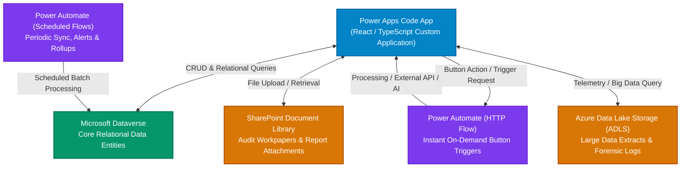

# Johnson & Johnson IAR (Intelligent Audit Reporting)
## System Requirements & Architecture Specification

---

## 1. Executive Overview & Purpose

**IAR (Intelligent Audit Reporting)** is an enterprise audit lifecycle application tailored for internal auditors, lead coordinators, audit managers, directors, executive vice presidents, and business stakeholders. The platform unifies audit execution, evidence management, AI-assisted finding synthesis, review workflows, and executive reporting into a cohesive experience.

---

## 2. Technology Stack & Enterprise Architecture

### 2.1 Core Platform Components
1. **Frontend**: **Power Apps Code App**
   - High-fidelity custom frontend built with modern React / TypeScript and enterprise component standards.
   - Embedded natively within Microsoft Power Platform Code Apps environment.
2. **Primary Storage**: **Microsoft Dataverse**
   - System of record for all structured relational data: Assessments, Engagements, Assignments, Test Procedures, Issues, AI Versions, Comments, and Review Trails.
3. **Integration & Automation Engine**: **Power Automate**
   - **HTTP-Triggered Flows**: Invoked via HTTP connector directly from action buttons inside the Code App (e.g., initiating AI generation, triggering approval hand-offs, dispatching executive notifications, report compilation).
   - **Schedule-Based Flows**: Periodic batch jobs (e.g., daily status aggregations, SLA tracking, stale issue alerts, scheduled data sync).
4. **File & Data Lake Storage**:
   - **SharePoint**: Document repository for workpaper attachments, evidence files, and generated final report packages.
   - **Azure Data Lake Storage (ADLS)**: High-scale audit datasets, continuous telemetry, log streams, and analytical data extracts consumed by the Code App.

---

## 3. Audit Lifecycle Phases & Module Scope

The audit lifecycle encompasses six distinct modules:

| Module / Phase | Role in Audit Lifecycle | Current Project Scope Status |
| :--- | :--- | :--- |
| **1. Pre-Planning** | Annual audit planning, portfolio assessment, risk universe analysis, resource readiness. | **Navigation Only** (Active tab & placeholder state) |
| **2. Planning** | Scoping, initial notification letter, stakeholder alignment, engagement budgeting. | **Navigation Only** (Active tab & placeholder state) |
| **3. Fieldwork** | Test procedure execution, sample testing, audit evidence documentation. | **Navigation Only** (Active tab & placeholder state) |
| **4. Reporting** | **Issue synthesis, AI generation/regeneration, multi-level review approvals, executive reporting, business responses, and final sign-off.** | **IN FULL SCOPE** (Primary focus of current development) |
| **5. Wrap-up** | Remediation tracking, workpaper archival, final close-out letters, audit committee submission. | **Navigation Only** (Active tab & placeholder state) |
| **6. Dashboards** | Executive KPI metrics, open issue heatmaps, aging analysis, cross-engagement trends. | **Navigation Only** (Active tab & placeholder state) |

> [!IMPORTANT]
> **Current Project Boundary**: All six modules remain visible and switchable in the global navigation bar. The development focus for this phase is dedicated exclusively to the **Reporting Module**, delivering all its functional workflows, review tiers, and data integrations.

---

## 4. Key Governance Roles in Reporting

The reporting workflow enforces a multi-tier governance model:

1. **Staff Auditor**: Logs findings, triggers initial AI synthesis, refines descriptions, and submits issues for review.
2. **Team Coordinator (TC)**: Reviews technical accuracy, evidence sufficiency, and workpaper standards.
3. **Audit Manager**: Conducts supervisory review, orchestrates business responses, and approves the issue package.
4. **Audit Director**: Performs formal executive review and executes final sign-off for standard audits.
5. **Vice President (VP)**: Mandatory executive sign-off authority if an engagement contains **one or more Critical issues**.
6. **Business Contact**: Receives routed findings during supervisory review to provide management responses, corrective action plans, and target remediation dates.

---

## 5. Architectural Alignment & Next Steps

With the architecture baseline established, detailed requirements discussion for the **Reporting Module** can proceed across:
- **Workpaper Structure**: Finding attributes (Header, Test Procedure, Root Cause, Impact, Recommendation).
- **AI Synthesis Lifecycle**: Generation, iterative refinement, side-by-side candidate comparison, and field-level hybrid adoption.
- **Workflow State Machine**: Status transitions from `Pending Staff` through `Pending TC`, `Pending Manager`, `Pending with Business`, `Pending Director`, and `Pending VP`.
- **Power Automate & Storage Connectors**: HTTP endpoint contracts, Dataverse schema mapping, SharePoint attachment APIs, and ADLS endpoints.
